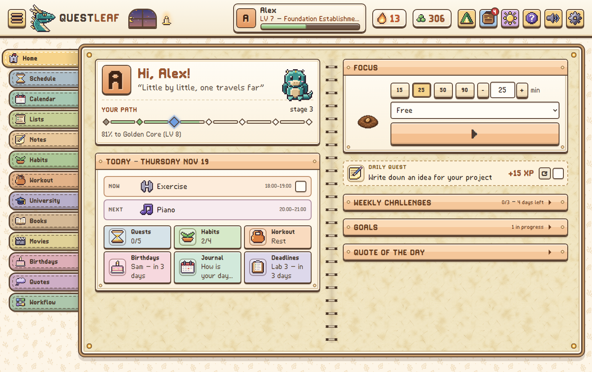
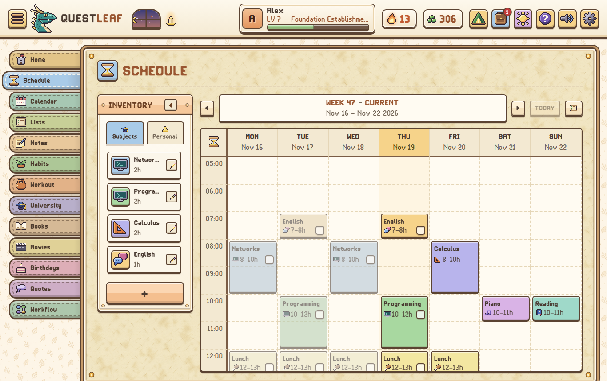
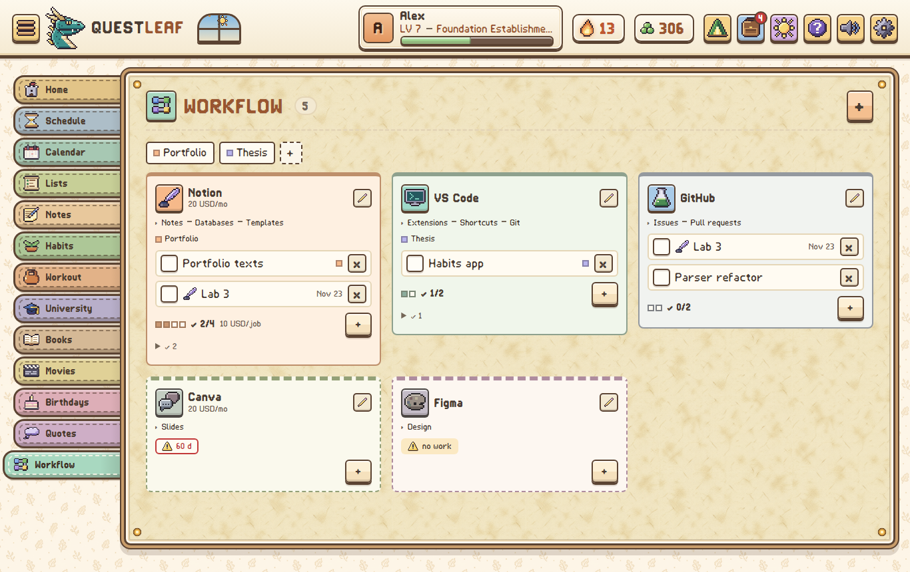
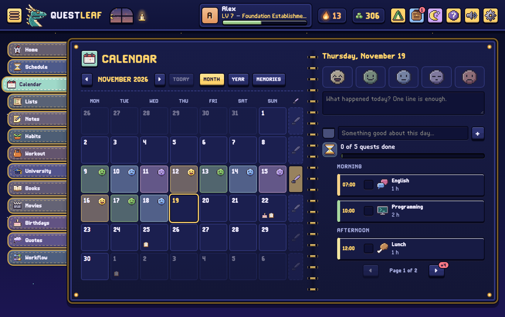
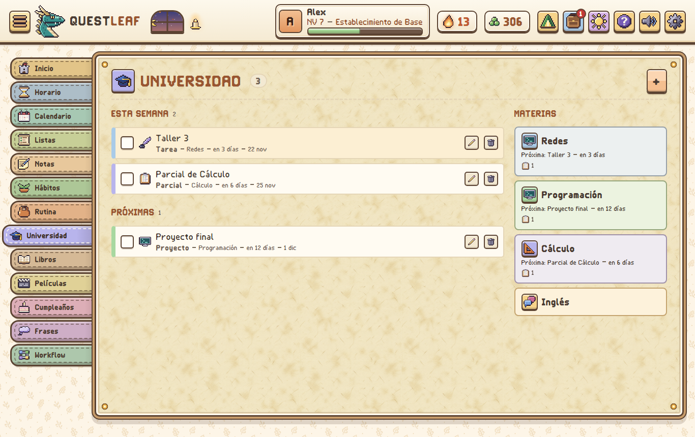

# Questleaf

A pixel-art adventure book for planning your days. Your schedule, habits, studies, reading and the apps you work
with live on its pages, and everything you finish turns into XP, levels and a small spirit beast that grows with you.



Windows 10 or 11, in English and Spanish. No account and no server: your save stays on your computer.

## Quick start

**Just use it:** download `Questleaf.exe` from [Releases](../../releases) and open it. Windows may warn you because the
app is not signed: **More info → Run anyway**.

**Run the code:** you need [Python 3.11+](https://www.python.org/downloads/) (check **Add python.exe to PATH** while
installing it) and [Git](https://git-scm.com/download/win). In PowerShell:

```powershell
git clone https://github.com/sebasGDevelop/questleaf.git
cd questleaf
.\run.bat
```

The first time takes a few minutes; after that `.\run.bat` opens it at once. No Git? **Code → Download ZIP**, unzip
it and double-click `run.bat`.

**Build your own .exe**, from the same folder:

```powershell
.\build.bat
```

It ends with `dist\Questleaf.exe`.

## What's inside

- **Schedule**: a weekly board of 1 to 3 hour blocks that you drag from an inventory of subjects and personal
  activities. Each block is a quest you can check off.
- **Home**: today at a glance (what's now and what's next), a focus timer, a daily quest, weekly challenges and your goals.
- **Calendar**: month and year views, a mood and one line for each day, a weekly chronicle, and a memories mode with a
  gratitude jar, time capsules and your year in review.
- **University**: deliverables grouped by week, a card per subject, and exam bosses that lose health while you study.
- **Workflow**: one block per app or account you use, the jobs it is doing for you (your own or University
  deliverables), project threads that connect apps, and whether a paid app is really paying off.
- **Lists**: to-dos (repeating ones too), shopping, subscriptions with their next charge, and budgets.
- **Notes** with bullets and a poem mode, **Habits** on the weekdays you choose, **Workout**, **Books** and **Movies**
  shelves with covers, **Birthdays** and **Quotes**.
- **Sanctuary**: a full-screen focus room with widgets, rain and fireplace sounds, and controls for the music you play in
  Spotify or any other app.
- A floating pomodoro, note and metronome that stay above other windows, Windows notifications, a backpack with
  today's notices, a reward shop, achievements, weather and seasons, day and night themes, and search with Ctrl+K.

## Screenshots

| Schedule | Workflow |
|---|---|
|  |  |
| **Calendar, night theme** | **University, in Spanish** |
|  |  |

## Your data

- The save is `%APPDATA%\Questleaf\save.json`. Once a day a copy goes to `Documents\Questleaf\Backups` (the last 30
  are kept), and **Settings → Save data** exports and imports it.
- Your own music goes in the `music` folder next to the app (see `music/README.txt`), or in **Settings → Sound and
  music**.
- Questleaf has no analytics. It only goes online to show the weather ([Open-Meteo](https://open-meteo.com)) and to
  find book covers ([Open Library](https://openlibrary.org)) and movie posters (Wikipedia and the iTunes Search API).
- To try things without touching your save, point `QUESTLEAF_DATA` (and `QUESTLEAF_BACKUPS`, `QUESTLEAF_MUSIC`) to
  other folders before starting the app.

## How it's made

The app itself is plain HTML, CSS and JavaScript in `web/`, with no framework and no build step. A small Python
program (`desktop/main.py`, with [pywebview](https://pywebview.flowrl.com)) opens it in a native window, saves the
game, keeps the backups and talks to Windows: notifications, the tray, the floating windows, start with Windows and
the media controls. Every visible text comes from `web/js/i18n/es.js` and `web/js/i18n/en.js`.

`.\run.bat --debug` opens the developer tools. For a quick look you can also open `web/index.html` in Edge or Chrome
(the save then lives in that browser, without the desktop extras).

## License

Questleaf is source-available under the [PolyForm Noncommercial License 1.0.0](LICENSE). You can use it, study it,
change it and share it for anything noncommercial: personal use, study, hobby projects, schools and other
noncommercial organizations. Selling it, selling a modified version or using it for a business needs my permission:
write to **sebasgdesign@gmail.com**.

Because it does not allow commercial use, this is not an open source license in the OSI sense. The third-party parts
listed below keep their own licenses.

## Credits

- [DotGothic16](https://github.com/fontworks-fonts/DotGothic16) by Fontworks, under the SIL Open Font License 1.1
  (`web/fonts/OFL-DotGothic16.txt`).
- The pixel icons, the spirit beast and the Aventura pixel font were drawn for Questleaf.
- Packaged with [PyInstaller](https://pyinstaller.org). The Windows executable includes Python,
  [pywebview](https://pywebview.flowrl.com) and other open source libraries; their licenses are in
  [THIRD-PARTY-NOTICES.txt](THIRD-PARTY-NOTICES.txt).
- Online data: weather by [Open-Meteo.com](https://open-meteo.com) (CC BY 4.0), book covers by
  [Open Library](https://openlibrary.org), film and series posters from Wikipedia / Wikimedia Commons and the
  iTunes Search API.

Made by [sebasGDevelop](https://github.com/sebasGDevelop).
